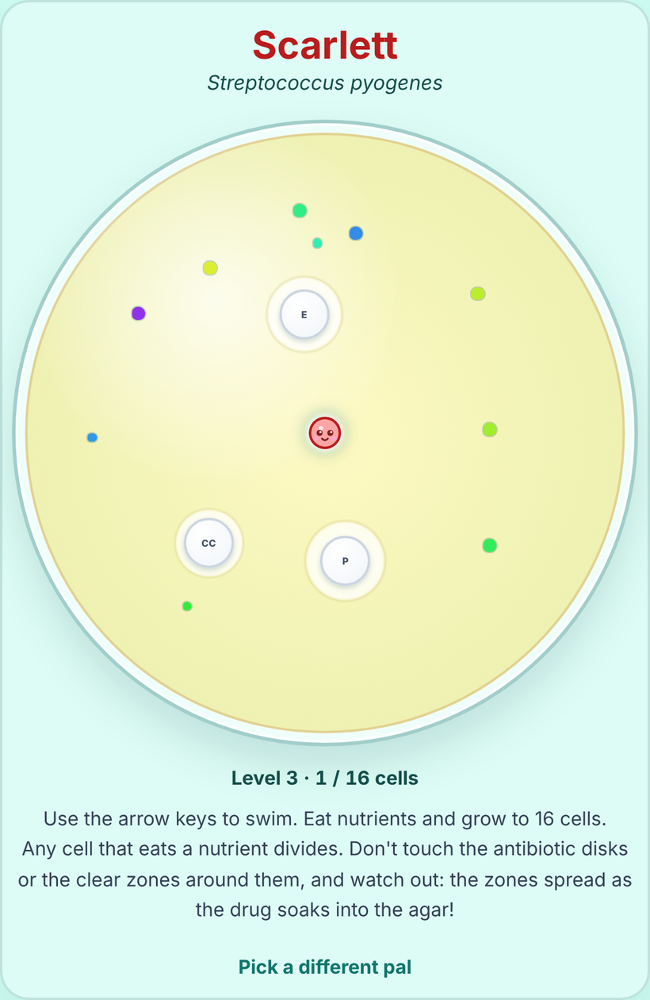
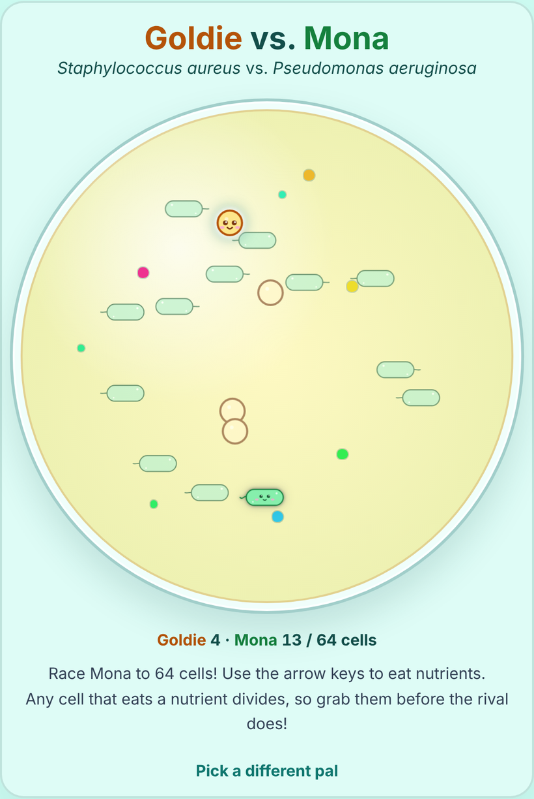

# PetriPals 🧫

A cute microbiology game for the browser. Pick a bacterial pal and eat nutrients to grow your colony. In **Classic** mode, steer clear of the antibiotic disks and their zones of inhibition. In **Mixed Culture** mode, race up to three rival pals to take over the plate. In **Petri Picnic**, there's no steering: sniff out food the way real swimming bacteria do. In **Phage Attack**, eat your fill before the viruses that hunt bacteria catch you.

**[▶ Play PetriPals](https://jessicasogge.github.io/petripals/)**: works on computers, phones and tablets.

 

## How to play

1. **Pick a pal.** Each one is a real bacterium, drawn as a cartoon.
2. **Choose a mode:** Classic, Mixed Culture, Petri Picnic, or Phage Attack. For Mixed Culture, pick up to three rivals, or tap **Surprise me** for one at random.
3. **Swim around the dish.** Use the arrow keys, or on a touch screen, drag your pal like a trackpad: touch anywhere on the dish and slide your finger, and she moves the same way. Your finger never hides her, and nothing moves when you touch down. Lift and touch again to keep going.
4. **Eat nutrients to divide.** Every cell that eats a nutrient divides in two, just like binary fission.

### Classic

Grow your colony to the target size to finish the level, but **don't touch the antibiotics.** Touching a disk, or the clear zone of inhibition around it, ends the game. Antibiotics kill bacteria! The zones start small and spread outward over the first few seconds, so grab the nutrients near the disks early.

There are seven levels. Each one adds another antibiotic disk and doubles the colony you need to grow, from 4 cells up to 256.

### Mixed Culture

No antibiotics this time. You share the plate with one to three rival pals steered by the computer. Pick them yourself (any pals but yours, each once; once there are more than 12 to choose from, the rival screen offers a random 12), or tap **Surprise me** for one at random. Against one rival, the **first colony to reach 64 cells wins**; against two or three, the dish fills up fast, so it's the **first to 32**. Each pal in the dish adds more nutrients, and **Race again** takes you back to pick your rivals. You get a one-second head start, and the rivals swim a little slower than you, but they're quick to spot the nearest nutrient, so grab them first!

### Petri Picnic

No steering this time. Your pal swims in a straight line on her own, and all you can do is make her **tumble**: tap the dish (or press the space bar or an arrow key) and she spins on the spot, then sets off a random new way. She bounces off the rim. Tumble when she's heading the wrong way, and grow to 256 cells. No rush, and no way to lose.

### Phage Attack

**Bacteriophages** (phages for short), viruses that infect bacteria, hunt your colony. There are five levels, and your pal eats **45 nutrients** to finish each one. Level 1 starts with one phage on the rim, level 2 with two, and so on up to five. Only the ones your pal eats herself count: her offspring eat and divide too, but don't add to the total. Phages go after your offspring first, so the cells you leave behind draw them away from your pal, but if she swims too close, they'll come for her. A phage that lands on one of your offspring infects it: the cell turns very dark and throbs, and a few seconds later it bursts and lets out two new phages, so every cell they catch makes more of them. A chain or cluster loses just the infected cell. If a phage lands on your pal herself, it's game over, and you can try that level again or start over from level 1. The level's phages start spread evenly around the rim. No more drift in after that: new ones only come out of the cells they burst, and there's no limit to how many there can be. You get a head start, and they're much slower than you, so keep moving.

### Who’s That Pal?

Tap **Who’s That Pal?** on the home page for a quiz on the pals' fun facts. Each round picks 12 pals at random (9 on a phone) and asks only about them. You get one fact with "this pal" in place of her name: tap the pal it's about. A wrong guess greys that pal out so you can try again, and the right one puts her name back in and shows her species. There's no score, so it's just for learning. A counter (like 2 / 70) shows how many of this round's facts you've seen, and you'll see each of them once before a new round picks more. The quiz skips facts too broad to point to one pal (like "is Gram-positive"); the ones it uses are listed in `public/game/quiz-facts.js`.

## The pals

| Pal | Species | Shape |
|---|---|---|
| **Penny** | *Streptococcus pneumoniae* | Bluish-purple pair of round cells, with glasses |
| **Vi** | *Vibrio cholerae* | Orange comma-shaped rod |
| **Goldie** | *Staphylococcus aureus* | Golden grape-like clusters of round cells |
| **Ana** | *Bifidobacterium bifidum* | Pink Y-shaped rod, cheering with her arms up |
| **Scarlett** | *Streptococcus pyogenes* | Red chains of round cells |
| **Coco** | *Haemophilus influenzae* | Small coffee-with-cream coccobacillus |
| **Mona** | *Pseudomonas aeruginosa* | Green rod with one flagellum |
| **Elia** | *Borrelia burgdorferi* | Purple corkscrew (spirochete) |
| **Ceres** | *Bacillus cereus* | Sky-blue chain of three square-ended rods |
| **Sallie** | *Salmonella* Typhi | Grey rod with flagella all around |
| **Terra** | *Clostridium tetani* | Olive drumstick: a slim rod with a round spore at one end |
| **Lissie** | *Listeria monocytogenes* | Short denim-blue rod with a few flagella |
| **Sara** | *Serratia marcescens* | Short, plump red rod with flagella all around |
| **Ivy** | *Bacillus mycoides* | Sage-green chain of rods curling up like a vine |
| **Astrid** | *Asticcacaulis biprosthecum* | Azure rod with two stalks near one end |
| **Kiki** | *Cronobacter sakazakii* | Short, plump lemon-yellow rod with flagella all around |
| **Electra** | *Geobacter sulfurreducens* | Grape-purple rod covered in sparking nanowires |
| **Diffany** | *Clostridioides difficile* | Big, plump chestnut-brown rod with flagella all around and an oval spore near one end |
| **Nova** | *Nocardia nova* | Teal, beaded filament that branches every which way |
| **Pearl** | *Klebsiella pneumoniae* | Short, plump pearly-pink rod in a thick, glossy capsule, with tiny pili all around |
| **Frannie** | *Francisella tularensis* | Small, plump coral coccobacillus with tiny bunny ears |
| **Colette** | *Escherichia coli* | Long, slim green-apple rod with flagella all around |
| **Dina** | *Deinococcus radiodurans* | Orchid square of four round cells (a tetrad) |
| **Ari** | *Anabaena variabilis* | Jade string of round cells with one pale gold heterocyst |

The picker shuffles all the pals each visit and shows them eight to a page, with **More pals** for the rest, so any pal can turn up on any page.

## The real science

The game is loosely based on real lab microbiology:

- **How each pal grows:** rods split and swim apart after dividing. Round cells (cocci) stay stuck together, in chains for *Streptococcus*, which divides in one plane, and in grape-like clusters for *Staphylococcus*, which divides in several. *Streptococcus pneumoniae* is a *Streptococcus* too, but it grows in pairs (diplococci), so Penny's chains stop at two cells. *Bacillus cereus* is a rod, but its cells often stay stuck end to end in short chains, so Ceres grows like a chain too, with rod-shaped cells, up to three at a time.
- **Sallie's flagella** cover her whole body (peritrichous flagella), unlike Mona's and Vi's single tail. Her species line reads *Salmonella* Typhi with Typhi upright: she's *Salmonella enterica* serovar Typhi, and serovar names are capitalized and never in italics.
- **Astrid's two kinds of cell:** *biprosthecum* means "two stalks," and *Asticcacaulis biprosthecum* grows them from her sides near one end, with a dab of glue (a holdfast) right at that end to stick to rocks and plants in ponds. Every division makes two different cells: one keeps her stalks, and the other is a swarmer, which swims off with a flagellum to find a new spot. A swarmer can't divide until she settles down, drops her flagellum and grows stalks of her own, and that's how Astrid grows in the dish too. Her stalked cells would really stay put, but in the game she swims anyway. There are no standard disk sizes for her, so her zones are estimates.
- **Kiki's yellow** is a pigment many *Cronobacter sakazakii* strains make, mostly at room temperature, like Sara's red. She's Gram-negative, so she turns pink in microscope mode. Her genus is named for Cronus, the Titan who swallowed his children, since she's best known for rare infections in newborns, often from powdered formula. There are no disk sizes just for *Cronobacter*, so her zones are ballpark figures for her order, Enterobacterales.
- **Diffany's spore** is oval and sits near one end of her rod but not at the tip (subterminal), so it bulges her outline a little. Terra's is round and right at the tip, which is how a microscope tells *Clostridioides difficile* and *Clostridium tetani* apart. Her rod turns purple in microscope mode, and her spore stays clear. She's named for *difficile*, Latin for "difficult," since she was so hard to grow, and she was moved out of *Clostridium* into her own genus in 2016. Few drugs work on her (antibiotics like ciprofloxacin and clindamycin are what let her take over the gut), so she has just three disks, vancomycin, metronidazole and rifampin, and later levels reuse them. She's an anaerobe, so her zones are estimates, like Terra's.
- **Nova's branches** are how *Nocardia* grows: thin filaments that branch off and branch again, nearly at right angles, where Ana splits just once into a Y. Her filaments take the Gram stain unevenly, so on a slide they look like strings of beads (they turn purple dots in microscope mode), and as her colony ages they snap apart into short rods. That's why she splits and slides apart in the dish like the other rods. She has no flagella. Labs test *Nocardia* by broth dilution rather than disks, so her zones are estimates; her erythromycin disk is a nod to the *N. nova* group, which, unlike most *Nocardia*, erythromycin usually works on.
- **Pearl's capsule** is the thick, slimy coat that makes *Klebsiella pneumoniae* colonies look wet, glossy and round, like pearls, and helps her hide from the immune system. It stays clear in microscope mode while her rod turns pink, since capsules don't take a Gram stain. She can't swim, so she has no flagella, but she's covered in tiny pili (fimbriae), short sticky hairs she uses to grip cells and medical tubing. Her pink is softer than Scarlett's, Ana's and Sara's, with a slate outline, and nods to the pink her colonies turn on MacConkey agar. There are no disk sizes just for *Klebsiella*, so her zones are ballpark figures for her order, Enterobacterales, and she has no ampicillin disk, since she's naturally resistant to it.
- **Frannie's bunny ears** are made up, a nod to tularemia, or “rabbit fever.” People can catch her through infected ticks, deer flies or animal contact. Her genus honors researcher Edward Francis, and tularensis refers to Tulare County, California. She’s a tiny Gram-negative coccobacillus like Coco, so she turns pink in microscope mode. She has no flagella and can’t swim. Penicillin doesn’t effectively treat her, so her disks include gentamicin, fluoroquinolones and doxycycline instead. Her zones are illustrative game values, not clinical test results.
- **Colette's long, slim rod** is *Escherichia coli*, about two to three times as long as she is wide, with flagella all around her like her cousins Sallie, Sara and Kiki. Her name comes from *coli*, "of the colon," where she lives. Her green is a nod to the metallic green sheen her colonies get on EMB agar, though real cells aren't green. She's Gram-negative, so she turns pink in microscope mode. There are no disk sizes just for *E. coli* (labs use the ones for her order, Enterobacterales), so her zones are ballpark figures. Her disks are drugs used for her urinary tract infections, starting with ampicillin, which, unlike Pearl, she isn't naturally resistant to.
- **Ari's beads** are how *Anabaena variabilis* grows: a filament of round cells joined end to end. She's a cyanobacterium, so she makes her own food from sunlight, and when nitrogen runs low some of her cells turn into heterocysts: bigger, paler, thick-walled cells that fix nitrogen from the air and share it with their neighbors for sugar. Real heterocysts come every 10 to 15 cells, but chains in the dish stop at eight, so every fifth cell she grows is one (the pale gold beads). Her real color is a blue-green, from chlorophyll and a blue pigment, phycocyanin. She's Gram-negative, so she turns pink in microscope mode. There are no standard disk sizes for her, so her zones are estimates, for drugs geneticists use on cyanobacteria.
- **Dina's squares** are tetrads: *Deinococcus radiodurans* divides in two directions at right angles, so her cells stick together in squares of four, and in the dish she grows that way too, four to a group. She's the toughest bacterium known, nicknamed "Conan the Bacterium": she survives about 1,000 times the radiation that would kill a person, and when it shatters her DNA she rebuilds it within hours. She was found in 1956, in canned meat that spoiled after being sterilized with radiation. Her name comes from *Deino*coccus. Real colonies are pinkish red, from a pigment called deinoxanthin; she's orchid so she doesn't look like Sara, Scarlett or Frannie. She's Gram-positive, so she turns purple in microscope mode. Labs don't test her with disks, so her zones are estimates, for drugs geneticists use on her.
- **Ivy's curl** comes from her colonies: *Bacillus mycoides* grows rhizoid (root-like) colonies that swirl as they spread, clockwise in some strains and counterclockwise in others. She's a soil bacterium, hence the green, and a cousin of Ceres in the *B. cereus* group, so she grows in chains of rods too, up to four in the dish. Unlike Ceres, she has no flagella. There are no standard disk sizes for her, so her zones are estimates.
- **Electra's nanowires** are the electrically conductive filaments *Geobacter sulfurreducens* is famous for. She lives in mud with no oxygen, so instead of breathing it she passes her spare electrons out along them to rust (iron oxide), which is why her bursts run out to the tips. The usual lab strain doesn't make flagella, so she has none. Her name is for the electricity she carries, and her purple is for fun: real cells are reddish from all their cytochromes. There are no standard disk sizes for her, so her drugs and zones are estimates.
- **Sara's red** is prodigiosin, a pigment many *Serratia marcescens* strains make, mostly at room temperature. It's why her colonies can look like drops of blood, and why she's behind the pink film in some showers. She's Gram-negative, so in microscope mode she turns pink like Mona and Vi, red pigment or not.
- **Terra's drumstick shape** is how *Clostridium tetani* really looks under a microscope: she makes a round spore at one end of her rod, wider than the rod itself. In microscope mode her rod turns purple but her spore stays clear, since spores don't take up a Gram stain. Her name is Latin for earth, where her spores wait in the soil. She's an anaerobe, and there are no standard disk sizes for anaerobes, so her zones are estimates too.
- **Lissie's flagella** are few and short-lived: *Listeria monocytogenes* tumbles end over end at room temperature but mostly stops making flagella at body temperature. Inside human cells she gets around a different way, by building a comet tail out of the cell's own actin. She never gets a cephalosporin disk, since cephalosporins aren't reliable against *Listeria*.
- **Ceres's name** is a nod to *cereus*, which means "waxy" in Latin but sounds like Ceres, the Roman goddess of grain. Fitting, since *B. cereus* is famous for growing on rice.
- **Ana's Y shape** is in her name: *bifidus* means "split in two," and bifidobacteria are rods that branch into a Y. She's one of the "good" gut bacteria (a probiotic), and her name is a nod to "anaerobe," since oxygen is bad for her.
- **Penny's glasses** are a nod to history: pneumococcus is the bacterium that helped show DNA carries genes, in experiments by Frederick Griffith (1928) and by Oswald Avery, Colin MacLeod and Maclyn McCarty (1944).
- **The antibiotic disks** are modeled on the Kirby-Bauer disk test. Each disk is a drug commonly used against that pal's species, labeled with its standard disk code (CIP for ciprofloxacin, P for penicillin, and so on).
- **Run and tumble** is how swimming bacteria find food (chemotaxis). They're too small to tell which side of them the sugar is stronger on, so instead they compare how sweet it smells now with a moment ago, and keep running while it's getting sweeter and tumble sooner when it isn't. Tumbling at random sounds aimless, but runs that are going the right way last longer, so the cell drifts toward the food. Pals with flagella all over (Colette, Sallie, Sara, Terra, Lissie, Ceres) really do tumble: their flagella fly apart and the cell spins. Colette (*E. coli*) is the bacterium run and tumble was discovered in. Mona and Vi, with one flagellum, mostly back up and flick to a new direction instead, and Elia flexes her corkscrew. Pals without flagella (Goldie, Scarlett, Penny, Coco, Ana, Ivy, Nova, Frannie, Dina, Ari) can't swim at all in real life, but in Petri Picnic every pal swims and tumbles, as they all swim in the other modes.
- **Phages** are viruses that infect bacteria, and they're everywhere bacteria are. The ones in Phage Attack are tailed phages like T4: a twenty-sided head packed with DNA, and a tail they land on and inject the DNA through. Inside, the cell is taken over to make new phages until it bursts open (lysis) and lets them out: that's the lytic cycle. A real burst lets out around a hundred phages, not two, and each kind of phage infects only a narrow range of hosts, so the game's generic phage that infects every pal is made up. On a lawn of bacteria, all that bursting leaves clear spots called plaques. Phages are being studied as a treatment for infections antibiotics can't cure (phage therapy).
- **A mixed culture** is a plate growing more than one species at once, all competing for the same nutrients. That's the idea behind the Mixed Culture race.
- **The zones spread** because the drug diffuses outward from the disk into the agar. Diffusion is quick at first and then slows down, so each zone widens fast and then creeps out to its full size. On a real plate this happens over hours of incubation; the game speeds it up to a few seconds.
- **The zones of inhibition** are sized from ballpark zone diameters a lab would measure for a susceptible strain of that species, scaled down to fit the dish. A bigger zone means the drug works better. *Borrelia* can't be grown for disk tests, so Elia's zones are made up from how well each drug works on her, and the same goes for Ana's and Ceres's (there are no standard disk sizes for bifidobacteria or *Bacillus*). Bifidobacteria are naturally resistant to gentamicin, so Ana's gentamicin disk has **no zone at all**: you can swim right up to it, but don't touch the disk itself. Ceres never gets a penicillin disk, because *B. cereus* makes beta-lactamases, enzymes that break penicillin and its relatives down.

## Running it locally

The game is plain HTML, CSS and JavaScript in [`public/`](public/), with no build step. To run it with the included dev server:

```sh
npm install
npm run dev
```

Then open http://localhost:3000.

## Tests

```sh
npm test                # run the tests
npm run test:coverage   # run them and check how much of the game they cover
```

The tests use [Vitest](https://vitest.dev/). Most of the game logic runs in [jsdom](https://github.com/jsdom/jsdom), a simulated browser page. The coverage check fails if the tests leave game code untested (the thresholds are in [`vitest.config.js`](vitest.config.js)), and the deploy runs it, so untested code doesn't ship.

## Project layout

| Path | What's there |
|---|---|
| `public/index.html` | Home page |
| `public/pal-picker.html` | Pick a pal |
| `public/choose-mode.html` | Choose Classic, Mixed Culture, Petri Picnic or Phage Attack |
| `public/choose-rivals.html` | Pick up to three rivals for Mixed Culture, or Surprise me |
| `public/petri-dish.html` | The game, in any mode |
| `public/whos-that-pal.html` | Who’s That Pal?, a quiz: which pal is this fact about? |
| `public/game/` | Game code: Classic mode (`game.js`), Petri Picnic (`tumble.js`), Phage Attack (`phage.js`), Mixed Culture mode (`race.js`, with each rival's steering in `rival.js` and who's racing in `rivals.js`, picked on `choose-rivals.js`), what both share (a colony eating and dividing in `colony.js`, steering in `keyboard.js` and `touch.js`), how the pals grow (`rod.js`, `coccus.js`), antibiotics (`antibiotic.js`), nutrients, physics, settings and fun facts (`config.js`), the fun-fact pop-up (`facts.js`, with italics for scientific names from `italics.js`), the picker's microscope mode (`stain.js`), the win confetti (`spores.js`), Who’s That Pal? (`whos-that-pal.js`, with the facts' "this pal" swap in `guess.js` and the facts it asks about in `quiz-facts.js`), and a little surprise on the home page (`split.js`) |
| `public/game/pals.js` | Every pal's name and drawing, in one place. All the pages draw the pals from here, in the order listed (except the picker, which shuffles them each visit), eight to a page (`PAGE_SIZE`). To add a pal, see the notes at the top. |
| `test/` | Tests |
| `src/index.ts` | Small Express server for local development |

## Deployment

Every push to `main` runs the tests and the coverage check and, if they pass, publishes `public/` to GitHub Pages (see [`.github/workflows/pages.yml`](.github/workflows/pages.yml)).

## Contributing

Bug reports, ideas and fixes are welcome! See [CONTRIBUTING.md](CONTRIBUTING.md) for how to get started, and please follow the [Code of Conduct](CODE_OF_CONDUCT.md).

## License

PetriPals is released under the [MIT License](LICENSE). The confetti uses [canvas-confetti](https://github.com/catdad/canvas-confetti), which is ISC licensed ([`public/game/vendor/confetti.LICENSE`](public/game/vendor/confetti.LICENSE)). The home page uses the [Fredoka](https://github.com/hafontia/Fredoka-One) and [Nunito](https://github.com/googlefonts/nunito) fonts, under the SIL Open Font License ([`public/fonts/`](public/fonts/)).

## Credits

Made by Jessica Sogge.
